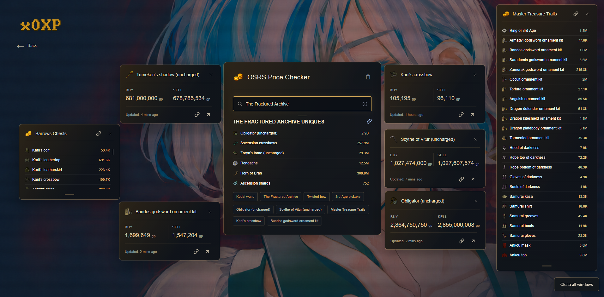
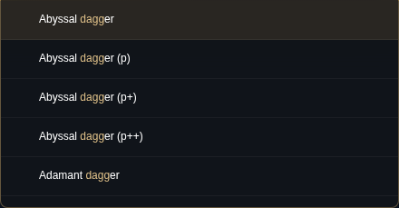

# x0XP

Tools by x0XP.

**Live site:** [x0xp.github.io](https://x0xp.github.io)

## Current tools

- **OSRS Price Checker** – Search items and bosses, check live prices and price history, pin favourites, and open draggable floating windows.
- **GitHub** – Browse repositories and open in-site details with README previews and links to source files.
- **Sol Heredit Trainer** – Practise the Colosseum boss encounter using our maintained [ColosseumTrainer fork](https://github.com/x0XP/ColosseumTrainer).

## Screens

### OSRS Price Checker



### Search suggestions



## Quick use

1. Open [x0xp.github.io](https://x0xp.github.io)
2. Choose **OSRS Price Checker**
3. Search an item or boss
4. Open results, pin searches, or drag cards into floating windows

## Tech

- HTML, CSS and vanilla JavaScript
- Shared card, button, typography and transition styles in `components.css`
- Repository detail screens in `repo-details.js` and `repo-detail.css`
- A local `github-data.json` snapshot keeps the GitHub list available if the public API is rate-limited; `github-data.js` refreshes it in visitors' browsers when permitted
- OSRS Wiki APIs for live item and boss data
- GitHub Pages for hosting
- Cloudflare Worker for share embeds

## Updates

The **Updates** panel reads from `price-checker-changelog.json`.

To add a new entry, place it at the top of the JSON array using this format:

```json
{
  "date": "YYYY-MM-DD",
  "title": "Short title",
  "changes": ["First change", "Second change"]
}
```
